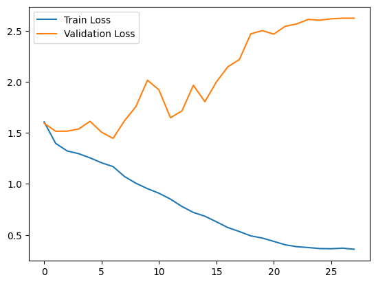
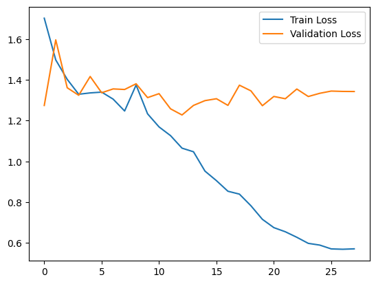
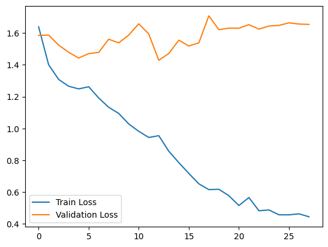

# BCI-I × IDUN EEG Analysis Challenge

A 1D CNN that classifies single-channel EEG epochs recorded with the IDUN in-ear device, validated with **leave-one-subject-out cross-validation** and ensembled across folds for the final submission.

<!-- TODO: add the competition link and your final leaderboard score -->

## Data

| File | Content |
|---|---|
| `S00{1,2,3}_X.npy` | EEG epochs, shape `(n_epochs, 7501)`: one channel, 7501 samples per epoch |
| `S00{1,2,3}_y.npy` | Marker label for each epoch (7 classes) |
| `S004_X.npy` | Unlabeled epochs from the test subject |

| Subject | Epochs | Role |
|---|---|---|
| S001 | 655 | train / val (fold 0) |
| S002 | 1064 | train / val (fold 1) |
| S003 | 823 | train / val (fold 2) |
| S004 | — | test |

The data is not included in this repo. Download it with `bash scripts/download_data.sh`, or run the first cells of the notebook; files go into `data/`.

## Approach

- **Preprocessing:** global z-score normalization. The mean and std are computed over all epochs, including the unlabeled S004 epochs (transductive normalization).
- **Augmentation** (each with p = 0.5): Gaussian noise (σ = 0.05), circular time shift (±10 samples), amplitude scaling (0.8–1.2).
- **Model:** a 3-block 1D CNN (Conv1d 32 → 64 → 128 channels, kernels 8 / 5 / 3, ReLU, dropout, max-pool) followed by an MLP head (256 units, dropout 0.5).
- **Training:** Adam (lr 1e-3), batch size 128, 28 epochs, cosine schedule with 5 warmup epochs. For each fold, the checkpoint with the best validation weighted F1 is kept.
- **Validation:** leave-one-subject-out. Each fold trains on two subjects and validates on the third, which measures how well the model generalizes to an **unseen person** — the realistic setting for EEG.
- **Inference:** the three fold models are ensembled on S004 by soft voting (averaged probabilities) and by hard voting (majority vote).

## Results

Best checkpoint per fold (selected by weighted F1):

| Held-out subject | Weighted F1 | Balanced accuracy |
|---|---|---|
| S001 | 0.423 | 0.272 |
| S002 | 0.546 | 0.299 |
| S003 | 0.394 | 0.269 |
| **Mean** | **0.454** | **0.280** |

Chance-level balanced accuracy for 7 classes is 0.143.

<p>
  
  
  
</p>

## Limitations

- **Class imbalance.** Weighted F1 is well above balanced accuracy, which means the model does much better on the frequent classes than on the rare ones.
- **Overfitting.** Training loss keeps falling while validation loss rises after roughly epoch 7–13 (see the plots).
- **Cross-subject variability.** Scores differ a lot between held-out subjects, as expected with only three labeled subjects.

## Next steps

- Select checkpoints by macro F1 or balanced accuracy (`train_model(..., monitor='macro_f1')`) and add class weights to the loss.
- Per-subject or per-epoch normalization to reduce inter-subject differences.
- EEG-specific architectures (e.g. EEGNet) or time–frequency features (spectrograms).

## How to run

```bash
pip install -r requirements.txt
bash scripts/download_data.sh
jupyter notebook notebooks/cnn_loso_baseline.ipynb
```

Run the notebook from the repo root (or adjust `DATA_DIR`). Training runs on CPU in a reasonable time and uses a GPU automatically if one is available. Submissions are written to `submissions/`.

## Repository structure

```
├── notebooks/
│   └── cnn_loso_baseline.ipynb   # full pipeline: data → training → ensemble submission
├── results/                      # loss curves per fold
├── scripts/
│   └── download_data.sh
├── requirements.txt
└── README.md
```
